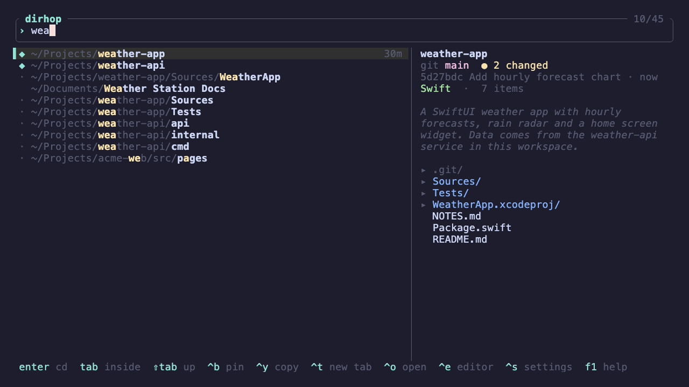
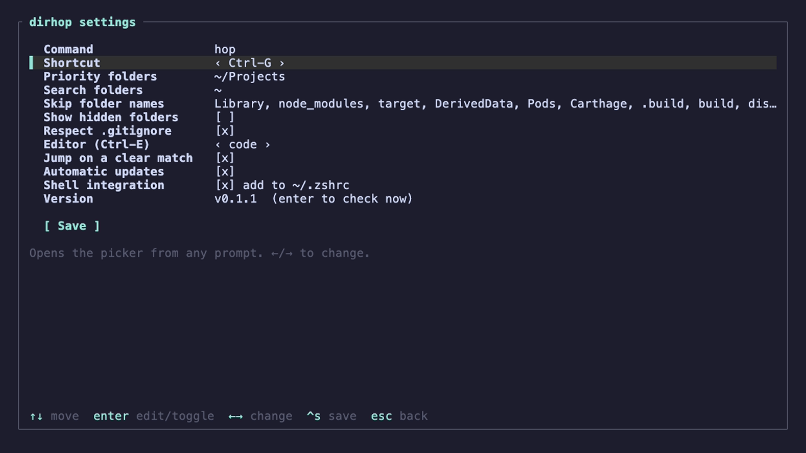

<div align="center">


# dirhop

**Jump to any folder in a few keystrokes.**
A fuzzy folder picker for your terminal, written in Rust. Type a few letters, hit Enter, and you're there.

[](https://github.com/jx-grxf/dirhop/actions/workflows/ci.yml)
[](https://github.com/jx-grxf/dirhop/releases/latest)

[](LICENSE)


[Install](#install) · [Usage](#usage) · [Settings](#settings) · [How it works](#how-it-works)

</div>

> [!TIP]
> Built for `cd ~/Projects/clients/acme/ios/App`. Type `hop acme`, or press <kbd>Ctrl</kbd>+<kbd>G</kbd> in the middle of a command.

## What it does

**Finds every folder, not just the ones you've visited**

- Searches your whole home folder. Most folder jumpers only know folders you've already been to.
- Opens instantly with the folder index from last time, then rescans in the background and adds new folders or drops deleted ones while you type.
- Git repos and folders in `~/Projects`, `~/Developer`, `~/code` and similar rank above the rest.

**Learns where you go**

- With an empty search you see pinned folders first, then the ones you visited recently, each with how long ago.
- <kbd>Ctrl</kbd>+<kbd>B</kbd> pins a folder so it stays at the top.
- Folders you pick often move up. If you use [zoxide](https://github.com/ajeetdsouza/zoxide), its history counts too.

**Skips the picker when it can**

- `hop dirhop` goes straight to the folder when one match clearly wins. If the answer isn't obvious, the picker opens with the search filled in.
- `hop -` goes back, `hop ..` and other paths work like `cd`.

**Shows what's inside**

- The preview shows the git branch, how many files changed, commits ahead or behind, the last commit, the detected language, the first lines of the README and the folder's contents.



**Does more than cd**

- Copy the path, open the folder in a new terminal tab (tmux, zellij, WezTerm, kitty, Windows Terminal, Terminal.app, iTerm2, Ghostty), in your file manager or in your editor.

**Stays out of your way**

- Pick a command name (`hop`, `p`, `j`…) and a shortcut in a small settings screen. No config files to edit.
- Updates itself from GitHub releases with SHA-256 verification. You can turn this off.

## Install

**macOS and Linux**

```sh
curl -fsSL https://raw.githubusercontent.com/jx-grxf/dirhop/main/install.sh | sh
```

**Windows** (PowerShell)

```powershell
irm https://raw.githubusercontent.com/jx-grxf/dirhop/main/install.ps1 | iex
```

**Homebrew**

```sh
brew install jx-grxf/tap/dirhop
dirhop setup
```

The install scripts download the right binary, check its checksum, put it in `~/.local/bin`
(Windows: `%LOCALAPPDATA%\Programs\dirhop`, added to your PATH) and open the setup screen. Pick a
command name and a shortcut, save, then open a new terminal.

<details>
<summary>Other ways to install</summary>

**With Cargo**

```sh
cargo install --git https://github.com/jx-grxf/dirhop
dirhop setup
```

**Manually.** Grab an archive from the [releases page](https://github.com/jx-grxf/dirhop/releases/latest),
put `dirhop` anywhere you like and run `dirhop setup`.

**Shell integration by hand.** `dirhop setup` adds one line to your shell config. To do it yourself:

```sh
# ~/.zshrc
eval "$(dirhop init zsh)"
# ~/.bashrc
eval "$(dirhop init bash)"
# ~/.config/fish/config.fish
dirhop init fish | source
```

```powershell
# $PROFILE
Invoke-Expression ((& dirhop init powershell) -join "`n")
```

</details>

Runs on macOS (Apple Silicon and Intel), Linux (x86_64 and arm64) and Windows (x64 and arm64),
with zsh, bash, fish or PowerShell.

## Usage

| | |
|---|---|
| `hop` | open the picker |
| `hop api` | jump to the best match for `api`, or open the picker if it's not clear |
| `hop -` | back to the previous folder |
| `hop ..`, `hop ~/x` | paths work like `cd` |
| <kbd>Ctrl</kbd>+<kbd>G</kbd> | open the picker from any prompt, even mid-command |

`hop` and <kbd>Ctrl</kbd>+<kbd>G</kbd> are the defaults. You choose both during setup.

**In the picker**

| Key | Action |
|---|---|
| type | fuzzy search (`'exact`, `^prefix`, `suffix$` and `!not` work too) |
| <kbd>Enter</kbd> | cd into the folder |
| <kbd>↑</kbd> <kbd>↓</kbd> / <kbd>Ctrl</kbd>+<kbd>P</kbd> <kbd>Ctrl</kbd>+<kbd>N</kbd> | move |
| <kbd>Tab</kbd> | search inside the highlighted folder |
| <kbd>Shift</kbd>+<kbd>Tab</kbd> | go up a level |
| <kbd>Ctrl</kbd>+<kbd>B</kbd> | pin or unpin |
| <kbd>Ctrl</kbd>+<kbd>Y</kbd> | copy the path |
| <kbd>Ctrl</kbd>+<kbd>T</kbd> | open in a new terminal tab |
| <kbd>Ctrl</kbd>+<kbd>O</kbd> | open in Finder, Explorer or your file manager |
| <kbd>Ctrl</kbd>+<kbd>E</kbd> | open in your editor (VS Code, Cursor, Zed, IntelliJ, Neovim…) |
| <kbd>Ctrl</kbd>+<kbd>S</kbd> | settings |
| <kbd>Ctrl</kbd>+<kbd>R</kbd> | rescan |
| <kbd>?</kbd> / <kbd>F1</kbd> | all keys |
| <kbd>Esc</kbd> | cancel |

## Settings

Run `dirhop setup` or press <kbd>Ctrl</kbd>+<kbd>S</kbd> inside the picker.



| Setting | Default |
|---|---|
| Command | `hop` |
| Shortcut | Ctrl-G (also Alt-J, Alt-G, Ctrl-Y, Ctrl-F, Ctrl-T or off) |
| Priority folders | whichever of `~/Projects`, `~/Developer`, `~/dev`, `~/code`, `~/src`, `~/repos`… exist |
| Search folders | `~` |
| Skipped folder names | `Library`, `node_modules`, `target`, `DerivedData`, `Pods`, `build`, `dist`, `.venv`… (and `AppData` on Windows) |
| Hidden folders | off |
| Respect `.gitignore` | on |
| Editor | the first one found on your PATH |
| Jump on a clear match | on |
| Automatic updates | on, checked at most once a day |

Settings live in `~/.config/dirhop/config.toml` (Windows: `%APPDATA%\dirhop\config.toml`), so you
can edit that file directly too. Jump history, pins and the folder index are stored in
`~/.local/share/dirhop/` (Windows: `%LOCALAPPDATA%\dirhop`).

## Commands

```text
dirhop [QUERY]         open the picker and print the chosen folder
dirhop setup           settings screen
dirhop init <shell>    print the shell integration (zsh, bash, fish, powershell)
dirhop query <QUERY>   print the best match without a UI (-n 10 for more, --scores to see the ranking)
dirhop index           rebuild the folder index now
dirhop update          update now
dirhop --version
```

Because dirhop prints the chosen path, it also works in scripts: `code "$(dirhop query api)"`.

## How it works

A program can't change your shell's working directory, so dirhop draws its UI on stderr and
prints the chosen folder on stdout. A small shell function then `cd`s there.

The scan uses the same parallel walker as ripgrep and covers about 5,000 folders in under 100 ms.
Every finished scan is saved as a folder index. The picker shows that index on its first frame
and lets the next scan correct it, and `hop name` and `dirhop query` answer from the index
alone in about 10 ms. When it is older than ten minutes, those two refresh it in the background.

Matching uses the fuzzy matcher from the Helix editor. Ranking combines match quality, whether
the folder is a git repo, pinned or inside a priority folder, how deep it is, and how often and
how recently you've picked it. While you keep typing, only the previous results are scored again.
`hop name` jumps when the best match leads the next one by a clear margin, which in practice
means an exact folder name.

Git details in the preview come from `git status` on a background thread, so moving through
the list never waits for git.

Updates come from this repo's GitHub releases. dirhop downloads the archive for your platform,
checks it against the published SHA-256 and swaps the binary atomically. Set
`DIRHOP_NO_UPDATE=1` or turn the setting off to skip this. Copies installed with Homebrew, Scoop or
Nix, or run straight from a Cargo `target/` folder, never update themselves.

## Uninstall

```sh
rm ~/.local/bin/dirhop
rm -rf ~/.config/dirhop ~/.local/share/dirhop
```

Then delete the `dirhop` line from your `~/.zshrc`, `~/.bashrc` or `~/.config/fish/conf.d/dirhop.fish`.
On Windows, delete `%LOCALAPPDATA%\Programs\dirhop`, `%APPDATA%\dirhop` and `%LOCALAPPDATA%\dirhop`,
and the `dirhop` line from your PowerShell profile.

## Development

```sh
cargo run -- setup                    # settings screen
cargo run -- query weather -n 5 --scores
cargo test && cargo clippy --all-targets
```

To cut a release, bump the version in `Cargo.toml` and push a `vX.Y.Z` tag. The release workflow
builds all six targets, publishes them with checksums and, when the `HOMEBREW_TAP_TOKEN` secret is
set, updates the formula in [jx-grxf/homebrew-tap](https://github.com/jx-grxf/homebrew-tap).
The demo GIF and screenshots are recorded with [vhs](https://github.com/charmbracelet/vhs) in a
throwaway home folder: `sh assets/demo-home.sh && vhs assets/demo.tape`.

## License

[MIT](LICENSE) © Johannes Grof
